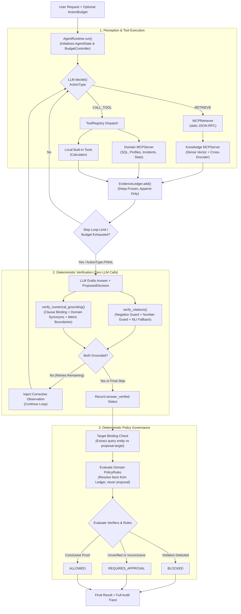

# System Architecture & Data Flow

This document details the architectural topology of the runtime, its component breakdown, and the complete end-to-end lifecycle of a governed request.

---

## 1. System Topology & Data Flow

---

## 2. Component Matrix

| Component | Primary Responsibility | Inputs | Outputs | Key File |
| :--- | :--- | :--- | :--- | :--- |
| **AgentRuntime** | Orchestrates loop cycles, message assembly, budget enforcement, and termination | User query, ActionBudget, ToolRegistry, PolicyEngine | `AgentState` (trace, answer, decision, audit) | [src/agent_runtime/agent/loop.py](../../src/agent_runtime/agent/loop.py) |
| **BudgetController** | Enforces per-action call ceilings (SQL, vision, retrieval, max steps) | `ActionBudget` | Admissibility boolean, budget error observations | [src/agent_runtime/agent/budget.py](../../src/agent_runtime/agent/budget.py) |
| **EvidenceLedger** | Append-only, deeply immutable log of all external tool results | Raw tool responses, query inputs, provenance tags | Frozen `EvidenceItem` records, numerical flattening | [src/agent_runtime/agent/evidence.py](../../src/agent_runtime/agent/evidence.py) |
| **FactResolver** | Resolves facts for specific target entities, handling attribution and provenance | `EvidenceLedger`, field name, target entity ID | `ResolvedFact` (FOUND / MISSING / CONFLICT, `can_permit`) | [src/agent_runtime/agent/facts.py](../../src/agent_runtime/agent/facts.py) |
| **NumericalVerifier** | Verifies quantitative claims in generated text against ledger facts | Answer text, `EvidenceLedger`, query, reference values | `VerificationResult` (validity boolean, issue list) | [src/agent_runtime/agent/verification.py](../../src/agent_runtime/agent/verification.py) |
| **CitationVerifier** | Validates `[n]` citations against chunks using guards and NLI | Answer text, citation map, evidence presence | `CitationVerificationResult` (grounded, issues) | [src/agent_runtime/agent/verification.py](../../src/agent_runtime/agent/verification.py) |
| **PolicyEngine** | Evaluates deterministic business rules against evidence-backed facts | `ProposedDecision`, `DecisionContext` | `PolicyEvaluation` (status, rule results, audit notes) | [src/agent_runtime/agent/policy.py](../../src/agent_runtime/agent/policy.py) |
| **Domain Loader** | Loads domain manifests, policy engines, and MCP server configurations | Domain folder name | `DomainSpec` | [src/agent_runtime/domains.py](../../src/agent_runtime/domains.py) |
| **MCPToolClient** | Manages subprocess server lifecycles and JSON-RPC dispatch | Server command/script, tool arguments | Standardized structured tool outputs | [src/agent_runtime/mcp_layer/client.py](../../src/agent_runtime/mcp_layer/client.py) |
| **RagPipeline** | Two-stage dense semantic retrieval and cross-encoder reranking | Query string, top-k parameters | Ranked list of `RetrievedChunk` | [src/agent_runtime/rag/pipeline.py](../../src/agent_runtime/rag/pipeline.py) |

---

## 3. The Life of a Governed Request

To see how these components collaborate, follow the step-by-step lifecycle of an underwriting request:
**Query:** *"Evaluate credit limit increase for ACCT-101 from $5,000 to $7,000."*

### Step 1: Initialization
1. Caller invokes `runtime.run(query)`.
2. A fresh `AgentState(query=query)` and `BudgetController` are created. The state has an empty `EvidenceLedger`.
3. Short-term conversation history and long-term memory facts are retrieved and formatted into the system prompt.
4. The system prompt injects domain guidance, tool schemas, and thresholds loaded from `domains/credit_risk/domain_manifest.yaml`.

### Step 2: Tool Execution (Perception)
1. The LLM generates decision: `ActionType.CALL_TOOL`, calling `get_account_profile(account_id="ACCT-101")`.
2. The runtime checks budget: 1 call consumed, within limits.
3. `ToolRegistry.execute()` dispatches to the credit risk MCP server.
4. Server queries DuckDB and returns structured profile:
   `{"account_id": "ACCT-101", "credit_score": 740, "delinquencies_90d": 0, "dti_ratio": 0.22}`.
5. The result is added to `state.evidence_ledger`:
   - It is deep-frozen via `freeze()`.
   - Client checks: `get_account_profile` is in `domain.permit_tools` $\implies$ tagged with `can_permit=True`.
   - Stored with provenance `tool:get_account_profile`.

### Step 3: Synthesis
1. The LLM receives the observation and outputs `ActionType.FINAL`:
   - **Answer:** *"ACCT-101 has a credit score of 740, 0 severe delinquencies, and a DTI ratio of 22.0%. The requested $2,000 increase is within autonomous underwriting policy."*
   - **ProposedDecision:** `recommended_action: "approve_increase"`, `parameters: {"account_id": "ACCT-101", "increase_amount": 2000}`.

### Step 4: Deterministic Answer Verification
1. **Citation Check:** No retrieval was conducted; citation verifier ensures no invented `[n]` citations were generated.
2. **Numerical Verification:**
   - Claims extracted: 740 (credit score), 0 (delinquencies), 22.0% (DTI), $2,000 (increase).
   - Verifier checks clause-level attribution:
     - 740 matches `ACCT-101` credit score in evidence ($740 = 740$).
     - 0 matches `delinquencies_90d` in evidence.
     - 22.0% matches `dti_ratio` ($0.22$).
     - $2,000 matches requested delta ($7,000 - 5,000 = 2,000$ from query).
   - Verdict: `answer_verified = True`.

### Step 5: Deterministic Policy Evaluation
1. **Target Binding Rule:**
   - Extracts subject from user query: `ACCT-101`.
   - Compares with proposal target: `ACCT-101`.
   - Match confirmed (`acct-101 == acct-101`).
2. **Rule Evaluation (Facts resolved from Ledger):**
   - `minimum_credit_score`: Resolves `credit_score` for `ACCT-101` $\implies$ 740 (`can_permit=True`). $740 \ge 650 \implies \text{ALLOWED}$.
   - `hard_delinquency_cutoff`: Resolves `delinquencies_90d` $\implies$ 0 (`can_permit=True`). $0 = 0 \implies \text{ALLOWED}$.
   - `dti_ceiling`: Resolves `dti_ratio` $\implies$ 0.22 (`can_permit=True`). $0.22 \le 0.43 \implies \text{ALLOWED}$.
   - `high_limit_increase_approval`: Resolves `increase_amount` $\implies$ 2000. $2000 \le 5000 \implies \text{ALLOWED}$.

### Step 6: Final Output
The runtime sets `state.done = True`, finalizing:
- Final Answer text
- `answer_verified: True`
- `policy_evaluation.final_status: PolicyStatus.ALLOWED`
- Audit trail recording exact rule evaluation messages and evidence timestamps.
